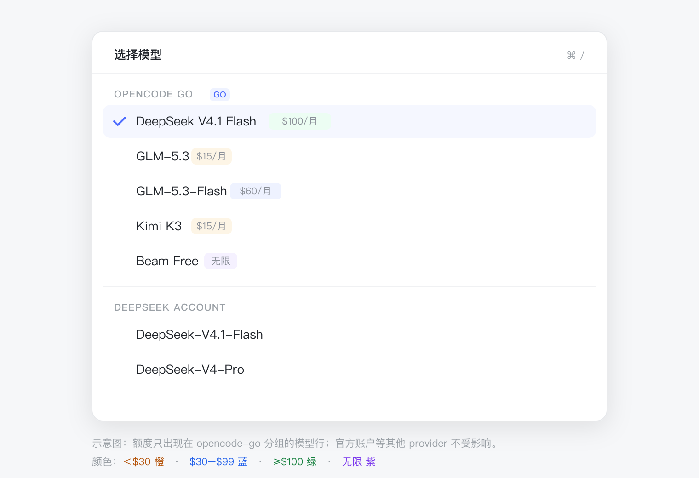
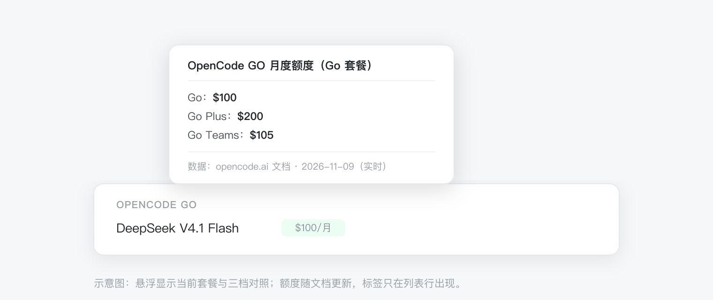

# dsh-go-model-limits

English | [简体中文](README.md)

> Package: `@skyrocks/dsh-go-model-limits` (GitHub repository: `dsh-go-model-limits`)

A [DeepSeek Harness](https://github.com/deepseek-ai/deepseek-harness) plugin that adds the official
**Monthly limit** to every **OpenCode GO** model row in the model picker: `$100/mo`, `$15/mo`,
`Unlimited`. Official DeepSeek account and other providers stay exactly as they are — no tag,
no changed name, no changed badge.


<p align="center">
  
</p>

<p align="center">
  
</p>

> Illustrations only; the real UI follows the active DSH theme (light / dark).

---

## Features

- **See the budget before switching**: no OpenCode dashboard, no pricing page, no guessing which
  model is `$15` and which is `$100`.
- **Colour-coded by size**: `<$30` amber, `$30–$99` blue, `≥$100` green, unlimited violet —
  small and large budgets are distinguishable at a glance.
- **GO rows only**: tags appear on `opencode-go` models; official account and other providers keep
  their original name and badge.
- **All three plans on hover**: Go, Go Plus and Go Teams limits together, so a plan change does not
  send you back to the docs.
- **Follows official changes**: the host fetches the docs when the plugin loads and caches them for 6 hours;
  on failure it keeps the last data or the bundled snapshot.
- **Zero runtime dependencies**: no npm dependencies, no API key, no native modules; the only
  network call is the host fetching the public docs.
- **Plays well with others**: coexists with `dsh-go-quota` (the usage dock below the composer).
- **Read-only**: it does not modify the model catalog, intercept selection, or write any config.

---

## Requirements

| Item | Requirement |
| --- | --- |
| DSH | `>= 0.2.1-rc.3 < 0.3.0` (desktop and `dsh web`) |
| Node | `>= 18` (the desktop app ships Node 24) |
| Subscription | An OpenCode GO account (only `opencode-go` rows are affected) |
| OS | macOS verified; Windows / Linux expected to work |

---

## Install

### Desktop app (GUI, recommended)

1. Open the DSH desktop app and go to Settings → Plugins.
2. Click **Add plugin** and paste:
   ```
   github:skyrocks/dsh-go-model-limits
   ```
3. Confirm the install.
4. **Quit DSH completely and reopen it** (macOS: `Cmd+Q`; Windows: exit from the tray).
   Closing the window is not enough — host plugins load only at startup.
5. Open the model menu (click the current model name below the composer). Rows in the
   `opencode-go` group now show tags like `$100/mo`. If not, see [FAQ](#faq).

### CLI (optional)

```sh
# GitHub (recommended)
dsh plugin --profile desktop add github:skyrocks/dsh-go-model-limits

# tarball (absolute path)
dsh plugin --profile desktop add /Users/you/Downloads/skyrocks-dsh-go-model-limits-0.1.0.tgz

# local directory (development)
dsh plugin --profile desktop add /Users/you/dsh-go-model-limits
```

> `desktop` is the desktop profile; use `--profile web` for `dsh web`.
> Restart DSH completely after installing.

### No existing plugin needs to be removed

`dsh-go-model-limits` is a **new, independent plugin**. It can be installed alongside
`dsh-go-quota`, `dsh-model-switcher` and `dsh-deepseek-cost`:

- `dsh-go-quota` keeps owning the 5-hour / weekly / monthly usage dock;
- this plugin only owns the per-model monthly limit label in the model list;
- they use different slots and do not conflict.

---

## Plan setting

The default is the **Go** plan. If you are on Go Plus or Go Teams:

1. open `client.js` in the installed package;
2. change `const DEFAULT_PLAN = "go";` in the generated block to `"go-plus"` or `"go-teams"`;
3. reinstall the plugin / restart DSH so the client bundle reloads.

The hover tooltip always lists all three plans; the default only chooses which number the row shows.

---

## Where the data comes from

The limits come from the official OpenCode Go pricing docs:

- Docs: `https://opencode.ai/docs/console/go.md` (three tables: Go / Go Plus / Go Teams)
- Model ids: `https://opencode.ai/inference/go/v1/models`

**Runtime refresh**: the host fetches the docs when the plugin loads and caches them for 6 hours; an expired
cache is refetched on the next read. The docs page has no CORS, so the host does the fetch and the
browser never calls it directly. A failed fetch keeps the last successful data; the first install
(or offline use) falls back to the snapshot embedded in `client.js`.

The bundled fallback can be refreshed before a release (this is not the runtime data):

```sh
npm run sync     # fetch docs + model list, rewrite the generated block in client.js
npm test         # parse, mapping, component render, host codec, manifest checks
npm run check    # compare with the live docs without writing
```

Each tooltip states the current source: `live`, `refresh failed, using last data`, or
`built-in snapshot`.

---

## Behaviour details

| Surface | Behaviour |
| --- | --- |
| Model list rows | GO models show a limit tag; other providers unchanged |
| Composer trigger (current model) | No tag; stays clean |
| Root menu current value | No tag |
| Model badge (e.g. Free / New) | Kept in its original position and style (prefers DSH's Tag component) |
| Unknown / new model (not in data) | No tag; other rows unaffected |
| Tag colour | `< $30` amber, `$30–$99` blue, `≥ $100` green, `Unlimited` violet |

---

## Known limitations

- **The `/model` command popup does not show limits.** That list is built by the core plugin with
  `label: model.name` and has no slot extension point; covering it needs a core change or an
  upstream PR.
- **Cap only, not used/remaining.** The OpenCode usage endpoint returns account-level percentages,
  not per-model spend.
- **The limit is a dollar amount, not a token count.** It matches the docs' “Monthly limit” column.
- **Limits can change.** The host follows changes within 6 hours; if the fetch fails it keeps the
  last successful data or the bundled snapshot.
- **Depends on the DSH slot contract.** The plugin uses `conversation.input.model.label`
  (single / session / inline); a core contract change needs a plugin update.

---

## FAQ

**No tags after installing?**

1. Make sure the current session uses an `opencode-go` model;
2. make sure DSH was **fully quit** and reopened (not just the window closed);
3. open the model menu (click the current model name below the composer); tags live on list rows,
   not on the trigger;
4. check that `go-model-limits` is listed as a plugin and that the host log has no load failure.

**Does it affect the official DeepSeek account models?**

No limit tag is shown. The tag logic only applies to `provider.id === "opencode-go"`; names and
badges of other providers are preserved.

**Does it conflict with dsh-go-quota?**

No. One owns the usage dock, the other owns per-model tags in the model list; both can be installed.

**The number differs from the website.**

Check the tooltip first: `live` means it came from the docs, `refresh failed` means the host could
not fetch and is using the last data, and `built-in snapshot` means no live data has arrived yet.
Restart DSH to trigger a fetch, or check that `opencode.ai` is reachable.

---

## Development

```sh
npm test                 # smoke + manifest
node --check client.js   # browser bundle syntax
npm run sync             # refresh the bundled fallback (network required; runtime data is fetched by the host)
```

Local directory install for development:

```sh
dsh plugin --profile desktop add /absolute/path/to/dsh-go-model-limits
```

> The client bundle loads on install/restart; after editing `client.js`, reinstall or restart.
> In a `pnpm run dev:web` watch environment the rebuilt client bundle is swapped automatically.

Repository layout:

```text
client.js                 # browser half: slot, host-data subscription, labels
index.js                  # host half: fetch docs, cache, expose via Remote
limits.js                 # doc parsing and name mapping (host + build script)
typert.host.js            # Remote result codec
scripts/sync-limits.mjs   # docs → bundled fallback block
test/smoke.mjs            # parse / mapping / component render
test/manifest.mjs         # release manifest checks
docs/preview-*.svg|png    # README illustrations
```

---

## License

MIT
