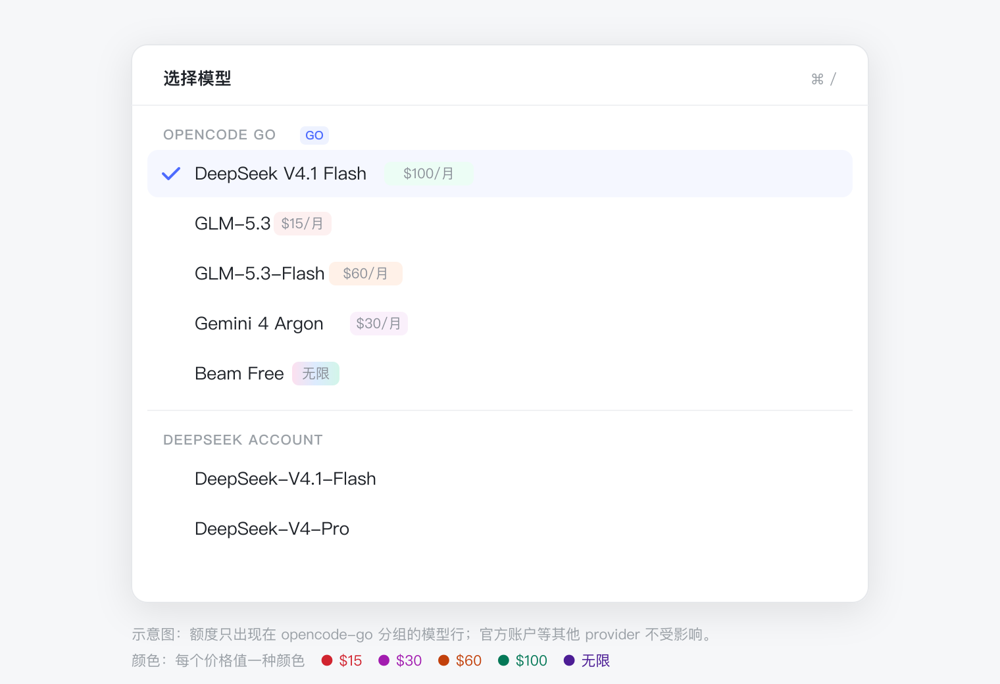
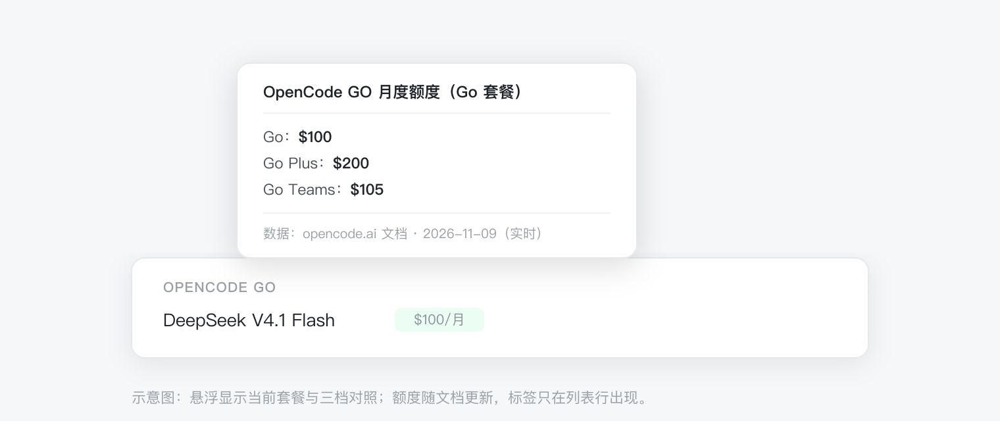

# dsh-go-model-limits

[English](README.en.md) | 简体中文

> 包名：`@skyrocks/dsh-go-model-limits`（GitHub 仓库名：`dsh-go-model-limits`）

在 **DeepSeek Harness** 的模型选择列表里，给 **OpenCode GO** 的每个模型名后面加上官方
**Monthly limit（月度额度）**：`$100/月`、`$15/月`、`无限`。官方账户等其他 provider
不显示任何标签，保持原样。


<p align="center">
  
</p>

<p align="center">
  
</p>

> 以上为界面示意图，实际样式跟随 DSH 主题（明 / 暗）。

---

## 为什么用它

- **选模型前先看额度**：不用去 OpenCode 官网翻价格表，也不用记哪个模型是 `$15`、哪个是 `$100`。
- **每个价格值一种颜色**：`$15`、`$30`、`$60`、`$100` … 各自独立配色，不按区间合并；`无限` 用渐变。
- **只影响 GO 分组**：标签只出现在 `opencode-go` 的模型行；官方账户、其他 provider 的名字和 badge 原样保留。
- **悬浮看三档**：Go / Go Plus / Go Teams 的额度一起列出，换套餐时不用重新查文档。
- **自动跟进官方调整**：Host 启动后抓官方文档，缓存 6 小时；抓不到时用上次数据或内置快照。
- **零运行时依赖**：没有 npm 依赖、没有 API Key、没有原生模块；唯一的网络请求是 Host 抓公开文档。
- **不抢别的插件**：与 `dsh-go-quota`（输入框下的用量条）并存，互不影响。
- **只读展示**：不修改模型目录、不拦截选择、不写入任何配置。

---

## 环境要求

| 项 | 要求 |
| --- | --- |
| DSH | `>= 0.2.1-rc.3 < 0.3.0`（桌面版与 `dsh web` 均可） |
| Node | `>= 18`（桌面版内置 Node 24） |
| 订阅 | 一个 OpenCode GO 账户（只影响 `opencode-go` 分组） |
| 系统 | macOS 已验证；Windows / Linux 预期可用 |

---

## 安装

### 在 DSH 桌面端安装（图形界面，推荐）

1. 打开 DSH 桌面端，进入插件管理页（设置 →「插件」）。
2. 点「添加插件」，在弹窗里粘贴：
   ```
   github:skyrocks/dsh-go-model-limits
   ```
3. 确认安装。
4. **完全退出 DSH 再重新打开**（macOS 用 `Cmd+Q`；Windows 从托盘退出）。
   只关窗口不够——Host 插件只在启动时加载。
5. 打开模型菜单（点输入框下方的当前模型名），`opencode-go` 分组里的模型会带 `$100/月` 这类标签。
   如果没出现，见[常见问题](#常见问题)。

### 从命令行安装（可选）

```sh
# GitHub（推荐）
dsh plugin --profile desktop add github:skyrocks/dsh-go-model-limits

# tarball（绝对路径）
dsh plugin --profile desktop add /Users/you/Downloads/skyrocks-dsh-go-model-limits-0.1.1.tgz

# 本地目录（开发调试）
dsh plugin --profile desktop add /Users/you/dsh-go-model-limits
```

> `desktop` 是桌面版 profile；如果你用的是 `dsh web`，换成 `--profile web`。
> 安装完成后同样要完全退出并重启 DSH。

### 不需要卸载任何现有插件

`dsh-go-model-limits` 是**独立的新插件**，和 `dsh-go-quota`、`dsh-model-switcher`、
`dsh-deepseek-cost` 可以同时存在：

- `dsh-go-quota` 继续负责输入框下方的 5 小时 / 周 / 月用量条；
- 本插件只负责模型列表里的每模型月度额度标签；
- 两者使用不同的 slot，不冲突。

---

## 套餐设置

默认按 **Go** 套餐显示。如果你用的是 Go Plus 或 Go Teams：

1. 打开安装目录里的 `client.js`；
2. 把 generated 区块里的 `const DEFAULT_PLAN = "go";` 改成 `"go-plus"` 或 `"go-teams"`；
3. 重新安装插件 / 重启 DSH（客户端 bundle 会重新加载）。

悬浮提示里始终列出三档额度，默认套餐只决定列表里显示哪一个数字。

---

## 数据从哪来

额度来自 OpenCode 官方文档的 Go 价格表：

- 文档：`https://opencode.ai/docs/console/go.md`（三张表：Go / Go Plus / Go Teams）
- 模型 id：`https://opencode.ai/inference/go/v1/models`

**运行时自动刷新**：Host 在插件加载后（客户端首次读取时）抓一次文档，缓存 6 小时；缓存过期后下一次读取会重新抓取。
文档页没有 CORS，所以由 Host 抓，浏览器不直接访问。抓取失败时保留上一次成功的数据；
首次安装或离线时，用 `client.js` 里内嵌的快照兜底。

发布前刷新兜底快照（不是运行时数据）：

```sh
npm run sync     # 抓线上文档 + 模型列表，重写 client.js 的 generated 区块
npm test         # 解析、映射、组件渲染、Host codec、manifest 自检
npm run check    # 只对比线上数据，不写文件
```

悬浮提示会标明当前数据来源：`实时` / `刷新失败，沿用上次数据` / `内置快照`。

---

## 行为细节

| 位置 | 表现 |
| --- | --- |
| 模型列表的选择行 | GO 模型显示额度标签；其他 provider 不变 |
| 输入框上的当前模型（trigger） | 不显示额度，保持干净 |
| 根菜单的「模型」当前值 | 不显示额度 |
| 模型 badge（如 Free / 新） | 保留原位置与样式（优先使用 DSH 的 Tag 组件） |
| 未知/新模型（数据里没有） | 不显示标签，不影响其他行 |
| 额度颜色 | 每个价格值一种颜色（不再按区间合并）；`无限` 用渐变 |

---

## 已知边界

- **`/model` 命令弹窗不会显示额度。** 那个列表由 DSH 核心插件直接拼
  `label: model.name`，没有 slot 扩展点；要覆盖只能改 DSH 核心或上游 PR。
- **只显示上限，不显示已用/剩余。** OpenCode 的 usage 接口只返回账户级百分比，
  没有按模型的用量数据。
- **额度是美元金额，不是 token 数。** 与官方文档的 “Monthly limit” 列一致。
- **额度可能变化。** 官方调整后，Host 最长 6 小时跟进；抓取失败时继续用上次成功数据或内置快照。
- **依赖 DSH 的 slot 契约。** 插件使用 `conversation.input.model.label`
  （single / session / inline）；core 若调整该契约，需要跟进升级。

---

## 常见问题

**装完没有标签？**

1. 确认当前会话选的是 `opencode-go` 的模型；
2. 确认已**完全退出** DSH 再打开（不是只关窗口）；
3. 打开模型菜单（点输入框下方的模型名），标签在列表行，不在 trigger 上；
4. 看插件列表里是否有 `go-model-limits`，以及 Host 日志有没有加载失败。

**会影响官方 DeepSeek 账户的模型吗？**

不会显示额度标签。标签逻辑只对 `provider.id === "opencode-go"` 生效；
其他 provider 的模型名和 badge 保持原样。

**和 dsh-go-quota 冲突吗？**

不冲突。两者一个管用量条，一个管模型行的额度标签，可以同时安装。

**标签数字和官网不一致？**

先看悬浮提示：`实时` 表示来自线上文档；`刷新失败` 表示 Host 抓取失败，正在用上次数据；
`内置快照` 表示还没拿到过线上数据。可以重启 DSH 触发一次抓取，或检查网络是否能访问
`opencode.ai`。

---

## 开发

```sh
npm test                 # smoke + manifest
node --check client.js   # 浏览器 bundle 语法
npm run sync             # 刷新内置兜底快照（需要网络；运行时数据由 Host 抓）
```

本地目录安装（开发调试）：

```sh
dsh plugin --profile desktop add /absolute/path/to/dsh-go-model-limits
```

> 客户端插件 bundle 只在安装/重启后加载；修改 `client.js` 后需要重新安装或重启。
> 如果在 `pnpm run dev:web` 的 watch 环境里开发，客户端 bundle 会随构建自动替换。

仓库结构：

```text
client.js                 # 浏览器半：注册 slot、订阅 Host 数据、渲染标签
index.js                  # Host 半：抓文档、缓存、通过 Remote 下发
limits.js                 # 文档解析与名称映射（Host / 构建脚本共用）
typert.host.js            # Remote 结果 codec
scripts/sync-limits.mjs   # 文档 → generated 兜底快照
test/smoke.mjs            # 解析 / 映射 / 组件渲染
test/manifest.mjs         # 发布清单自检
docs/preview-*.svg|png    # README 示意图
```

---

## 许可

MIT
